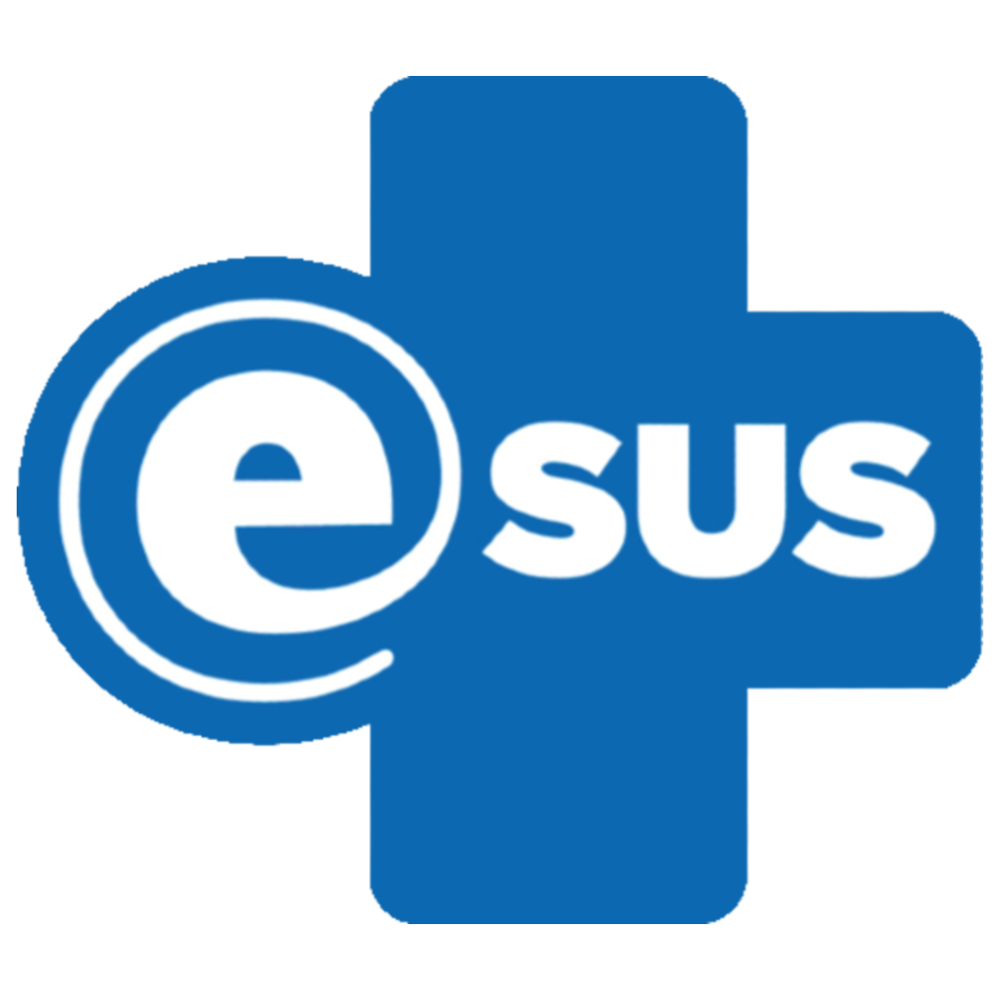

## About me

I'm a full-stack software developer with around two years of professional experience. I build scalable applications with a focus on workflow optimization, healthcare solutions, data visualization, and applied AI.

## Areas of Expertise

- **Software Architecture** — Structure scalable applications for maintainability.
- **Workflow & Process Management** — Translate operational needs into organized workflows.
- **Healthcare Solutions** — Develop applications and integrations for healthcare workflows.
- **Data Visualization & Analytics** — Turn data into accessible indicators, dashboards, and analytical interfaces.
- **Artificial Intelligence** — Apply AI to software development, automation, and product solutions.

## Tech Stack

 **Frontend** · React, Vite  
 **Backend** · Spring Boot, Laravel, Node.js  
 **Database & Infrastructure** · PostgreSQL, Supabase  
 **Design & Prototyping** · Figma

## Selected Projects & Professional Experience

###  nextOrganize

*Personal Project · Productivity & Workflow Management*

A customizable platform for managing tasks, organizing activities, and structuring workflows.

[View repository](https://github.com/yuggo-dev/nextOrganize)

###  EsusData

*Professional Experience · Proprietary Software*

**BR Consultoria e Desenvolvimento Profissional** · Full Stack Development Intern · Dec 2024 – Jul 2026

- Built e-SUS integrations, REST APIs, patient call panels, and dashboards for healthcare indicators using React, Laravel, PostgreSQL, and Spring Boot (Java).
- Built solutions used in technical proposals for municipal tenders, helping secure and renew contracts and expand the public-sector client base by up to two municipalities.

## Education

**Universidade Federal de Mato Grosso do Sul (UFMS)**  
B.Sc. in Information Systems · Bacharelado em Sistemas de Informação  
2023 – Present

Leia em português

Sou desenvolvedor de software fullstack com cerca de dois anos de experiência profissional. Desenvolvo aplicações escaláveis com foco em organização de fluxos, soluções para a saúde, visualização de dados e inteligência artificial aplicada.

**Áreas de atuação** · Arquitetura de software, gestão de processos, soluções para a saúde, análise e visualização de dados e IA aplicada a software e automação.

**nextOrganize** · Projeto autoral de uma plataforma personalizável para gerenciamento de tarefas, organização de atividades e estruturação de fluxos de trabalho.

**EsusData · BR Consultoria e Desenvolvimento Profissional** · Estagiário em Desenvolvimento Fullstack · dez/2024 – jul/2026

- Desenvolvi integrações com o e-SUS, APIs REST, painéis de chamada e dashboards de indicadores de saúde com React, Laravel, PostgreSQL e Spring Boot (Java).
- Desenvolvi soluções usadas em propostas técnicas de licitações municipais, contribuindo para a aprovação e renovação de contratos e para a expansão da base de clientes públicos em até dois municípios.

## GitHub Contributions

[View my contribution activity](https://github.com/yuggo-dev#contributions)

<!-- After both SVGs are available in the output branch, remove this comment around the picture.
<picture>
  <source media="(prefers-color-scheme: dark)" srcset="https://raw.githubusercontent.com/yuggo-dev/yuggo-dev/output/snake-dark.svg" />
  <source media="(prefers-color-scheme: light)" srcset="https://raw.githubusercontent.com/yuggo-dev/yuggo-dev/output/snake-light.svg" />
  
</picture>
-->

<!--
## Connect
Add confirmed links for LinkedIn, portfolio, and professional email.
-->
