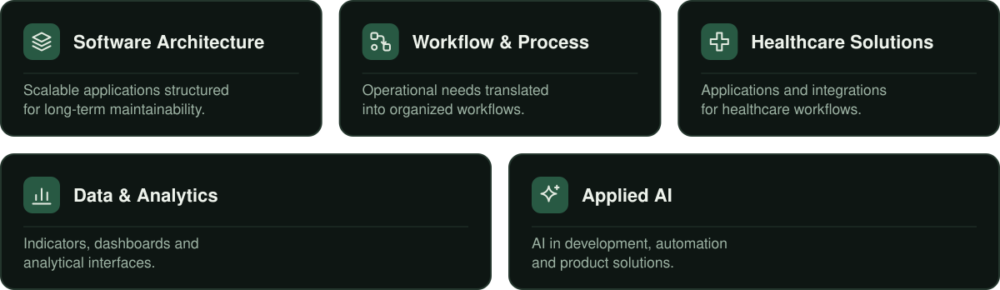
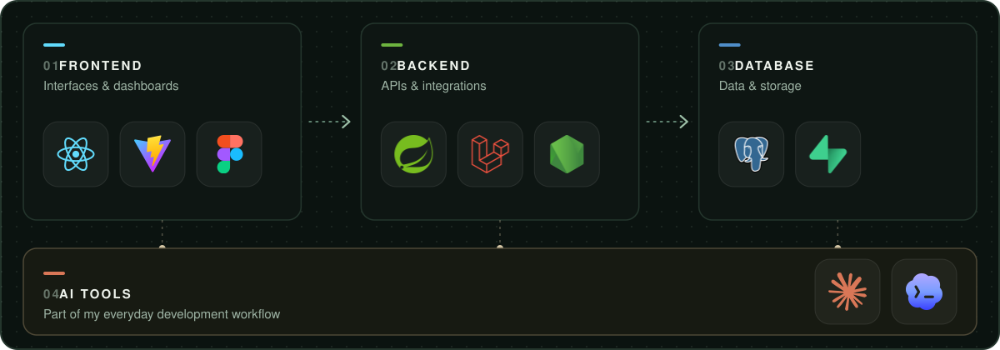
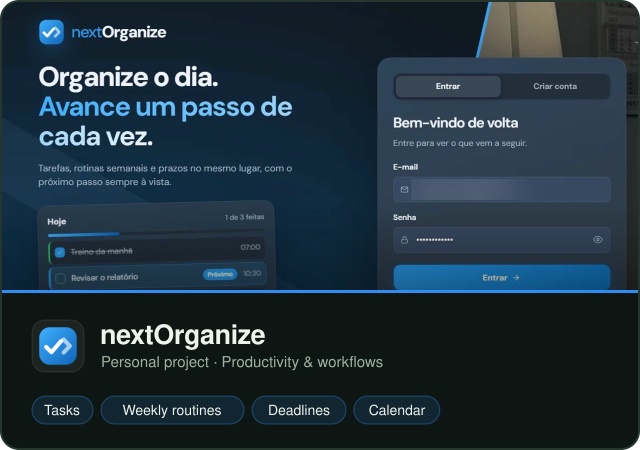
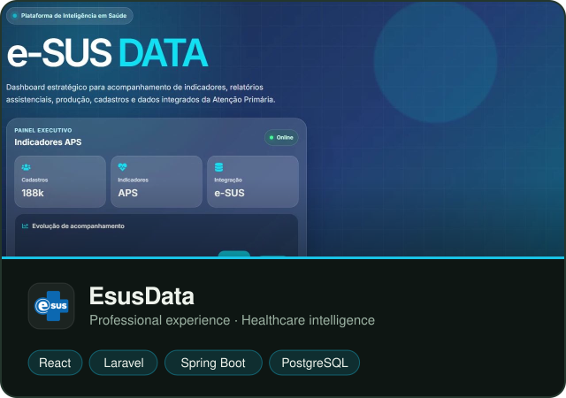
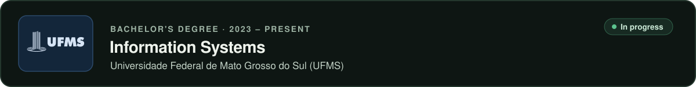

<b>English</b> · <a href="README.pt-BR.md">Português</a>

  

## About me

I'm a full-stack software developer with around two years of professional experience. I build scalable applications with a focus on workflow optimization, healthcare solutions, data visualization, and applied AI.

## Areas of Expertise

## Tech Stack

## Selected Projects & Professional Experience

<table>
  <tr>
    <td width="50%" valign="top">
      
      
A customizable platform for managing tasks, organizing activities, and structuring workflows.

      <ul>
        <li>Tasks, weekly routines, and deadlines in one place</li>
        <li>Monthly calendar with recurring routines</li>
        <li>Custom task types with color and icon</li>
      </ul>
      
<a href="https://github.com/yuggo-dev/nextOrganize"><b>View repository →</b></a>

    </td>
    <td width="50%" valign="top">
      
      
Full Stack Development Intern at <b>BR Consultoria e Desenvolvimento Profissional</b> · Dec 2024 – Jul 2026

      <ul>
        <li>Built e-SUS integrations, REST APIs, patient call panels, and dashboards for healthcare indicators.</li>
        <li>Built solutions used in technical proposals for municipal tenders, helping secure and renew contracts and expand the public-sector client base by up to two municipalities.</li>
      </ul>
      
Proprietary software

    </td>
  </tr>
</table>

## Education

<!--
## Connect
Add confirmed links for LinkedIn, portfolio, and professional email.
-->
