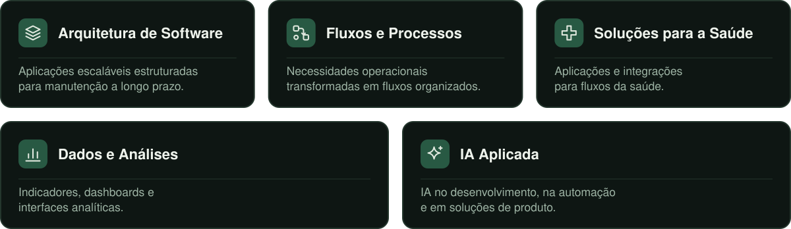
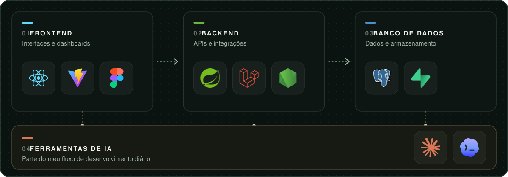
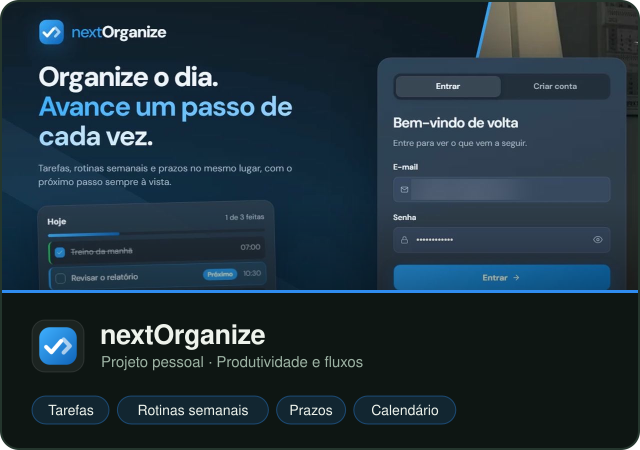
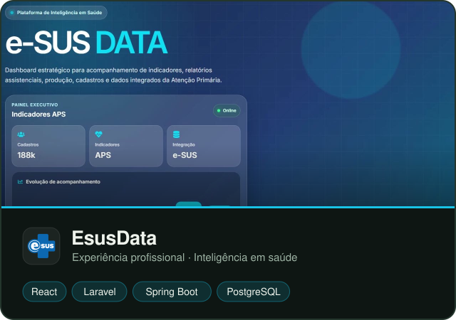
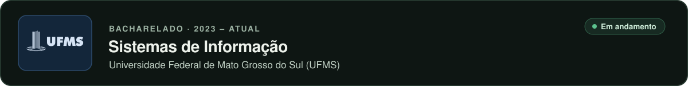

<a href="README.md">English</a> · <b>Português</b>

  

## Sobre mim

Sou desenvolvedor de software fullstack com cerca de dois anos de experiência profissional. Desenvolvo aplicações escaláveis com foco em organização de fluxos, soluções para a saúde, visualização de dados e inteligência artificial aplicada.

## Áreas de Atuação

## Tecnologias

## Projetos e Experiência Profissional

<table>
  <tr>
    <td width="50%" valign="top">
      
      
Plataforma personalizável para gerenciamento de tarefas, organização de atividades e estruturação de fluxos de trabalho.

      <ul>
        <li>Tarefas, rotinas semanais e prazos no mesmo lugar</li>
        <li>Calendário do mês com rotinas que se repetem</li>
        <li>Tipos de tarefa com cor e ícone</li>
      </ul>
      
<a href="https://github.com/yuggo-dev/nextOrganize"><b>Ver repositório →</b></a>

    </td>
    <td width="50%" valign="top">
      
      
Estagiário em Desenvolvimento Fullstack na <b>BR Consultoria e Desenvolvimento Profissional</b> · dez/2024 – jul/2026

      <ul>
        <li>Desenvolvi integrações com o e-SUS, APIs REST, painéis de chamada e dashboards de indicadores de saúde.</li>
        <li>Desenvolvi soluções usadas em propostas técnicas de licitações municipais, contribuindo para a aprovação e renovação de contratos e para a expansão da base de clientes públicos em até dois municípios.</li>
      </ul>
      
Software proprietário

    </td>
  </tr>
</table>

## Formação

